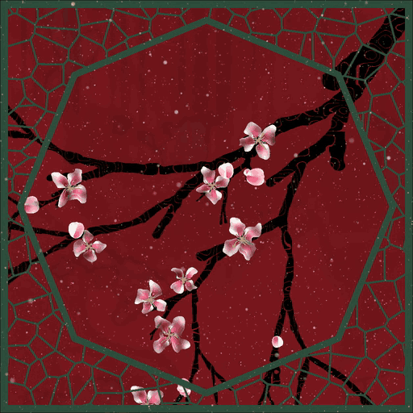
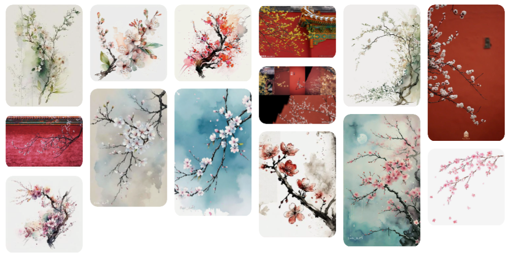
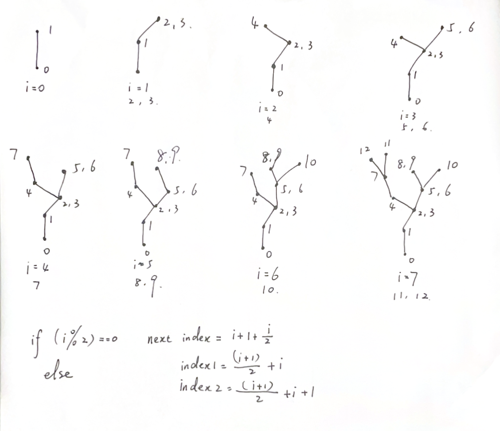

# Mei Flower Sketch 

Plum blossoms, often regarded as the Flower Deity of January in Transiditional Chinese Culture, symbolize the beginning of a new year. Blooming alone in the heart of winter, they represent the qualities of resilience and elegance. And the qualities represented by the flower deity symbolizes the characteristics possessed by those born in this month.

https://anyemelody.github.io/MeiSketch/

## Interaction
The tree reacts to clicks on the canvas:
1. Click a branch and the branches around the click are pushed down, then sway back slowly. Thick branches are stiff and slow, twigs are loose and a little quicker, and the flowers swing along with the branch they sit on.
2. Click the same spot several times in a row and the flowers there start to lose petals. How many petals fall is random, and the further a flower is from the click, the fewer it loses. The petals tumble and drift on their way down.
3. Every few seconds a new bud appears at a random spot on the branches and slowly opens into a flower. A flower that has lost all of its petals withers, which makes room for a new one.

## How to use
The effect is written in GLSL and [canvas-sketch](https://github.com/mattdesl/canvas-sketch) for printing use cases. All original files are in `src` folder. 
Download the `src` folder for local use,  
 
command to preview the effect:

`canvas-sketch index.js --open`

to print the effect: cmd+s

## Inspiration
The visual inspiration of this project is from the snow scene of the Forbidden City. The red walls and green windows are the most iconic features of the Forbidden City, as well as the most representative features of Chinese traditional architecture.

## Code Structure
The code is written in GLSL and JavaScript and consists of four parts: 
1. "flower.frag" which defines the visual effect of the flower and the branches.
2. "tree.js" which generates the branch skeleton and animates it: the sway, the falling petals and the blooming.
3. "windowPattern.frag" which defines the visual effect of the window frame pattern.
4. "snow.frag" which defines the visual effect of the snowing scene. And I referred the snowing effect from: https://www.shadertoy.com/view/Mdt3Df

### "flower.frag"
For the branch design, I used the fractal tree algorithm and applied random to the branch rotation angle. The length and width of the branches are using simple noise function and set connections between the preview branches properties to make the branches look more natural.

The positions of the branches are calculated in "tree.js" and sent to the shader, the shader draws each branch and gives it its width.

I have also added noise pattern to the branches to create some visual effects.

            float pattern = smoothstep(0., 0.1, fract((1. - noise(restSt * 30.)) * 5.));

The noise of a branch is read at the place where the branch rests, not where it currently is. This way the width and the pattern move together with the branch when it sways.

For the flower design, I mainly used the Rose curve function with perlin noise to generate the natural petal shape. Applied simple noise to the petal color to create the light and dark contrast and make the flower look more realistic.

            float petalNoise = perlin(st * 40.);
            vec2 endPoint = rosegraph(petalRadius, 1., j);
            endPoint.y *= slim; //make the petal slim 
            endPoint += vec2(petalNoise * wobble); //make the petal shape has more dynamic shape
            petalAlpha = segment(pos, centerPoint, endPoint, 0.005);
            //use point on petal to do color manipulation
            float dis = distance(pos, centerPoint);
            float r = distance(centerPoint, endPoint);
            petalAlpha *= petalNoise * 0.2 + 0.9;//alpha variation 
            float saturate = remap(dis, 0.0, r, baseSaturate, tipSaturate) - petalNoise * 0.3;
            float brightness = petalNoise * light + lightBase;
            vec3 c = vec3(hue, saturate, brightness);
            c = hsv2rgb(c);
            vec4 petalLine = vec4(c, petalAlpha);
            petalColor = mix(petalColor, petalLine, petalAlpha);

For an open flower `slim` is 0.7, `wobble` is 0.01, the saturation goes from 0.8 to 0.2 and the brightness is `petalNoise * 0.5 + 0.7`. A bud uses slimmer, more saturated petals folded together like a closed fan, and these values change gradually while it opens.

### "tree.js"
The branch skeleton is built with the same fractal tree rule as in the sketch above. Each branch is a damped spring around its joint: a click gives the nearby branches an impulse, a branch carries all of its child branches with it, and each child lags a little behind its parent.

Each flower remembers how much it was shaken for about two seconds, so only quick clicks in the same place add up. Once that passes a threshold, each petal has a chance to come loose, and the chance drops with the distance to the click. A falling petal is still drawn by the shader as the same petal of its flower, only moved and rotated, so it keeps its shape and gloss.

All the numbers for tuning the motion are at the top of the file, for example `PUSH_STRENGTH`, `SHED_THRESHOLD` and `BLOOM_SECONDS`.

### "windowPattern.frag"
Got inspiration from the window pattern of the Forbidden City. I generated the window pattern by using the Voronoi pattern and combined with the sdf shape to create the window frame. Feel free to change the window pattern by tweaking the GUI on the preview page.
